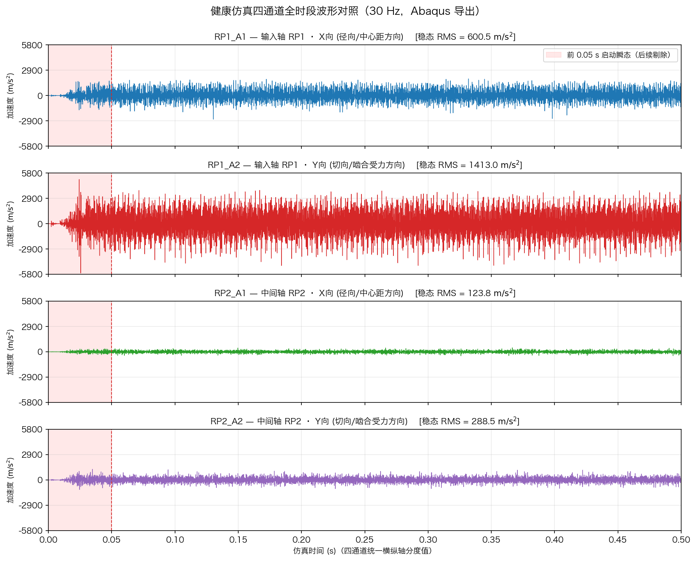
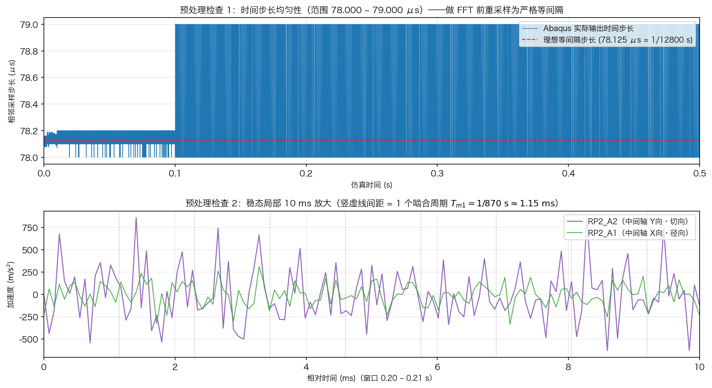
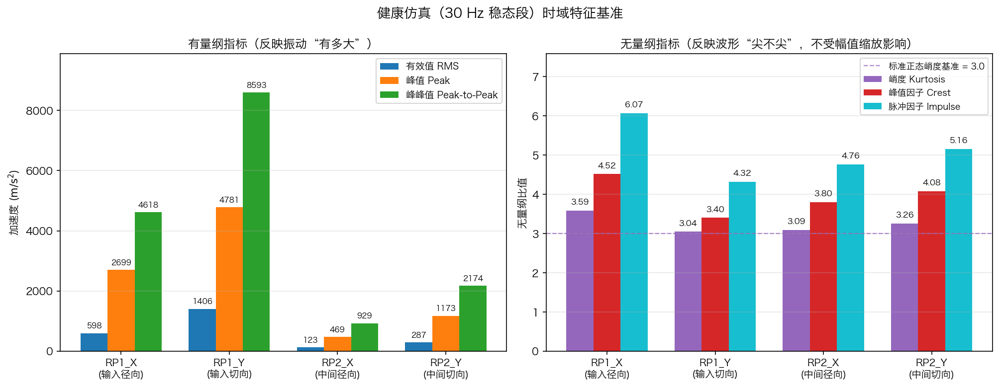
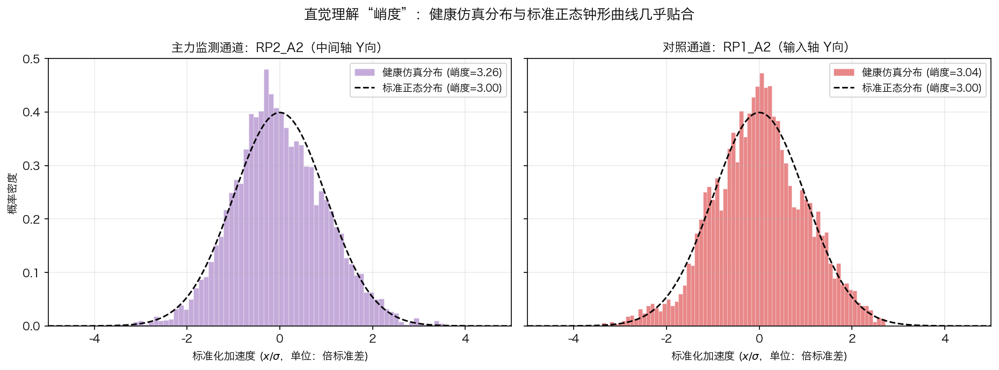
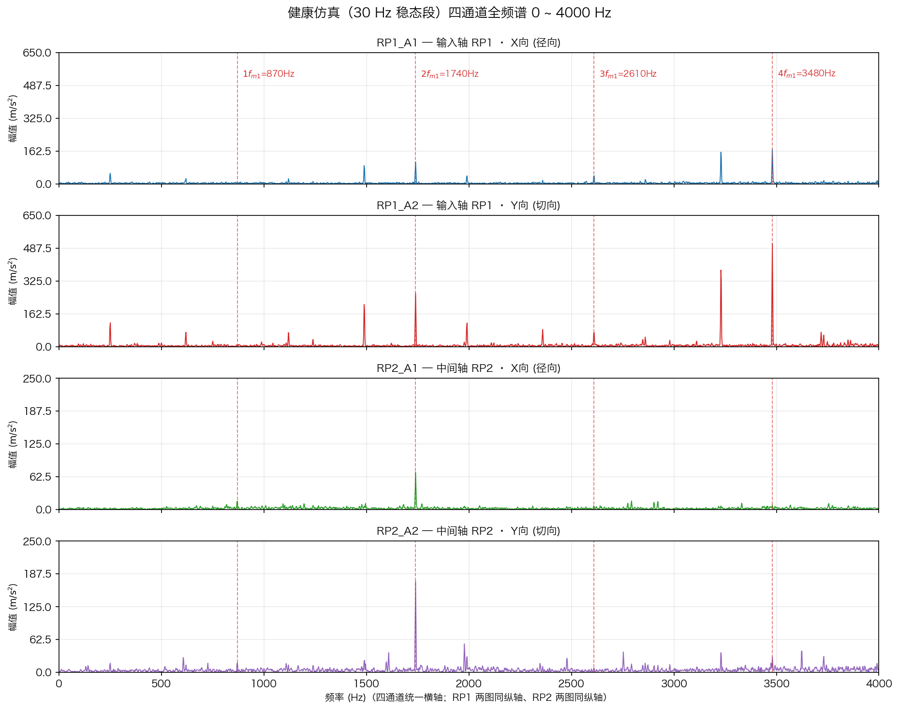
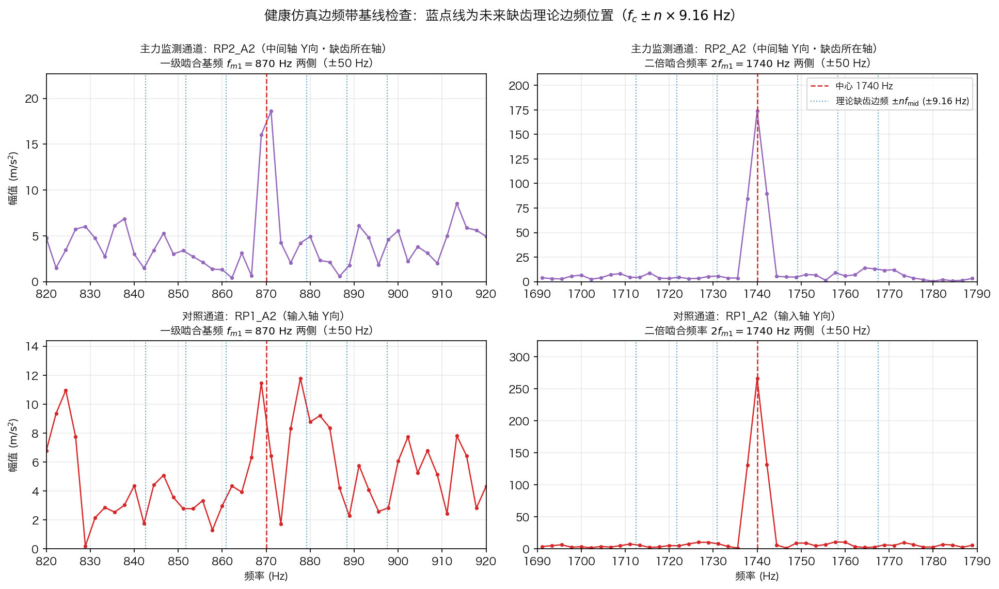
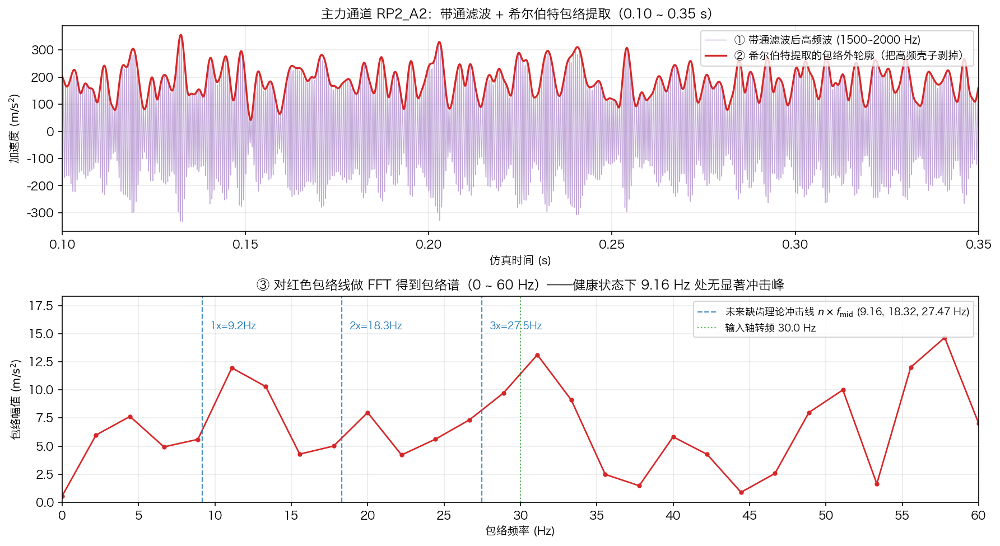
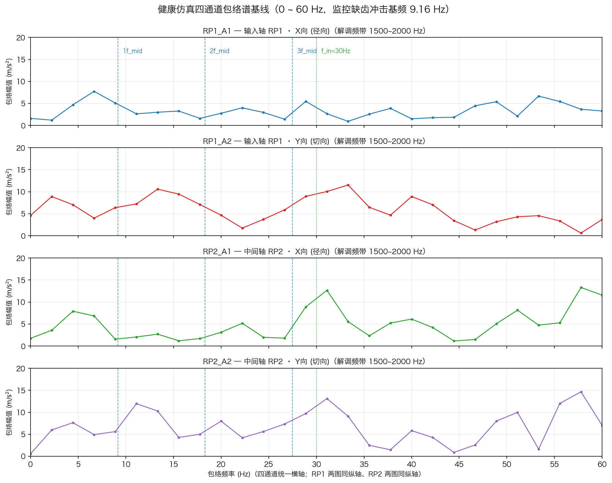
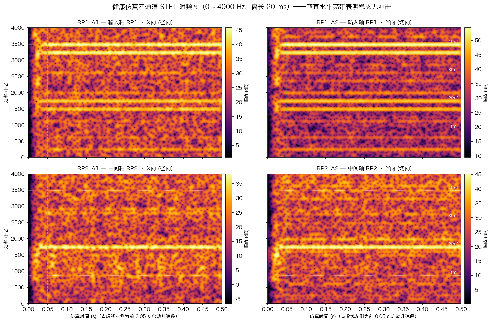
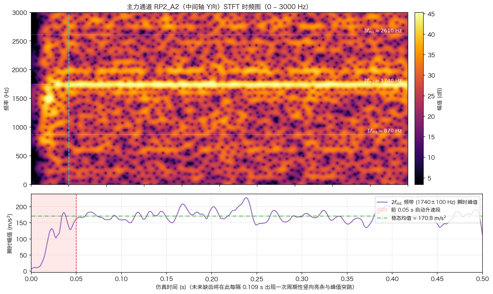

## 在第一阶段

在仿真数据的频域中，发现：2 倍啮合频率有明显高峰。

---

## 健康仿真数据分析手记
> **分析对象**：Abaqus 第一级齿轮副健康基准仿真
> **工况参数**：输入轴转频 $f_{\text{in}} = 30\text{ Hz}$（1800 rpm），中间轴转频 $f_{\text{mid}} = 9.16\text{ Hz}$，一级啮合频率 $f_{m1} = 870\text{ Hz}$，目标采样率 `12800 Hz`，时长 `0.5 s`。

---

### 步骤 1：数据体检与四通道预处理

- **预处理**
  1. **剔除前 `0.05 s` 启动瞬态**
  2. **等间隔重采样（`12800 Hz`）**：统一线性重采样到严格 `78.125 μs`，换算为 $\text{m/s}^2$。

---

### 步骤 2：健康仿真时域特征指标提取

---

### 步骤 3：频谱分析与边频带健康基线

- **核心物理收获**：
  1. **$2f_{m1}, 4f_{m1}$ 明显高于 $1f_{m1}$**：① 齿轮重合度 $\varepsilon_\alpha = 1.746$（75% 双齿 / 25% 单齿刚度交替），偶次谐波本身强；② 加速度天然放大高频（$\omega^2$ 效应）；③ $2f_{m1}$ / $4f_{m1}$ 更靠近系统固有频率共振区。
  2. **非啮合频率的凸起**：中心弹簧-阻尼支承使系统存在 `~251 Hz` 的低阶固有晃动；由 $F(t) = k(t)\cdot x(t)$，低频晃动同时引起**调幅（AM）**和**调频（FM）**，在各阶啮合频率两侧甩出 `±251 Hz` 边频（如 `1740 ± 251 = 1489 / 1991 Hz`），且因 AM（左右同号）与 FM（左右异号）叠加导致左右边频一高一矮。
  3. **健康边频基线**：在 $2f_{m1} = 1740\text{ Hz}$ 两侧 `±9.16 Hz` 处几乎平贴底噪（边频比仅 **`3.1% ~ 4.2%`**）。

---

### 步骤 4：包络解调基线分析（希尔伯特包络谱）

- **目的与原理**：缺齿每转一圈（`9.16 Hz`）的瞬时硬撞击激起齿轮-轴承的高频共振。通过 **带通滤波 → 希尔伯特提取外轮廓包络 → 对包络做 FFT**。
- **依据**
  1. **啮合主峰 + 边频阶数公式法**：以主导啮合谐波为中心（如 $2f_{m1}$），带宽取 $\pm (5\sim 10) f_{\text{mid}}$ 完整包住目标边频且避开相邻谐波；
  2. **快速谱峭度（Fast Kurtogram）**：自适应计算各子频带峭度，客观选出冲击信噪比最高的最优解调频带（缺齿数据出来后重点使用）；
  3. **Abaqus 模态分析（`Frequency` Step）**：直接算出系统精确固有频率作为共振频段力学依据。
- **结果**：健康仿真四通道在 `9.16 Hz` 处的包络峰噪比仅 **`1.25 ~ 2.21`**，无显著周期性冲击，成功建立健康包络基线。

---

### 步骤 5：STFT 时频图平稳性验证

- **目的**：普通 FFT 丢失时间信息，STFT 用 20 ms 滑动窗口同时呈现“时间 + 频率”二维演化，验证健康稳态平稳性，并为未来缺齿每隔 `0.109 s` 出现的竖向宽带冲击亮条立对照基线。
- **结果**：`0.05 s` 后四通道在啮合频率处呈现笔直均匀的水平亮带（无周期性竖向冲击）；主力通道 `RP2_A2` 稳态时频能量波动 CV 仅 **`6.07%`**，其中 $2f_{m1}$ 频带（`1740 ± 100 Hz`）占 0~4000 Hz 总能量的 **`40.66%`**。

